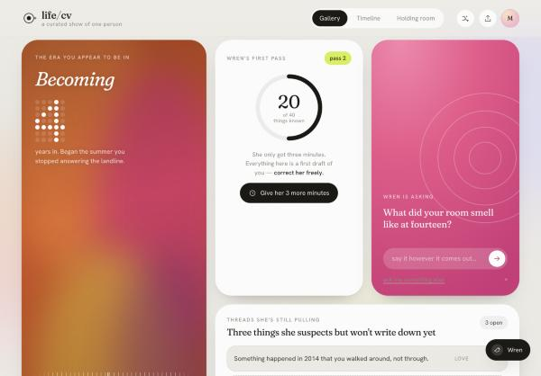
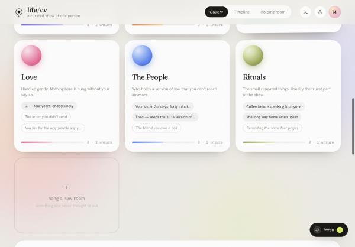

# life/cv

**[Open the gallery →](https://noorbsharma21.github.io/life-cv/)**

A dashboard for the CV of a life.

An input agent — **Wren** — interviews you for three minutes and then builds a curated show of
everything she heard: music, art, work, love, the people, rituals. She only gets what she can in
three minutes, so the first pass is thin and wrong in places. This dashboard is where you correct
her, and where the show gets better every pass.




## The idea

The premise is that a first pass is a **first draft of a person**, not a profile. So the interface
is built around correction rather than display:

- Every entry carries a source — *your words*, *wren guessed*, *wren confirmed*.
- Guesses hang dashed and unsure, with **she's right** / **she's wrong** on each one.
- Anything Wren heard but couldn't place lands in a **holding room** for you to file.
- Rewriting a guess in your own words silently reassigns it to you. The show stops being hers.
- **Threads she's still pulling** are the things she suspects but won't write down yet.

## What's in the gallery

| | |
|---|---|
| **The era** | What you appear to be in, in dot-matrix numerals. Rename it; switch eras. |
| **Wren's first pass** | How much she has, out of how much she thinks exists. |
| **Wren is asking** | The live question. Answer it and it files itself into a room. |
| **The rooms** | Six walls, editable in a drawer: add, rewrite, reorder, move, take down. Hang new rooms she never thought to ask about. |
| **The long line** | The years she has something for. Editable in place. |
| **Holding room** | Loose fragments, waiting to be filed. |
| **Pulled for you** | Things she thinks belong in your show. Hang them, or tell her no. |

## The iterative part

The interview isn't over. **Give her 3 more minutes** starts a real countdown: rapid questions,
each answer filed live into a room, the gallery visibly changing underneath you. Pull a thread and
she asks about that instead. Open a room and ask her to dig there.

## Running it

No build step, no dependencies.

```bash
open life-cv.html
```

`life-cv.html` is the built single file — open it anywhere. The source lives in `index.html` +
`styles.css` + `app.js`; rebuild the single file with:

```bash
python3 build.py
```

State is kept in `localStorage` under `lifecv.v2`. Nothing leaves the browser. **Export** downloads
the whole life as JSON; **start this life over** returns it to Wren's first pass.

## Notes on the build

- Routing is currently a keyword lexicon (`LEXICON` / `guessRoom` in `app.js`) standing in for real
  extraction — typed answers are matched to a room, and unmatched ones go to the holding room.
- Type is Fraunces (display, italic, with the SOFT and WONK axes doing the whimsy) and Hanken
  Grotesk (UI), with DM Mono for the agent's own voice.
- The numerals are a hand-rolled 5×7 dot-matrix renderer, not a font.
- Reduced-motion is respected; the mesh gradients and floating orbs stop.

The seeded life (Mira) is fictional — a stage to interact with, not anyone's data.
